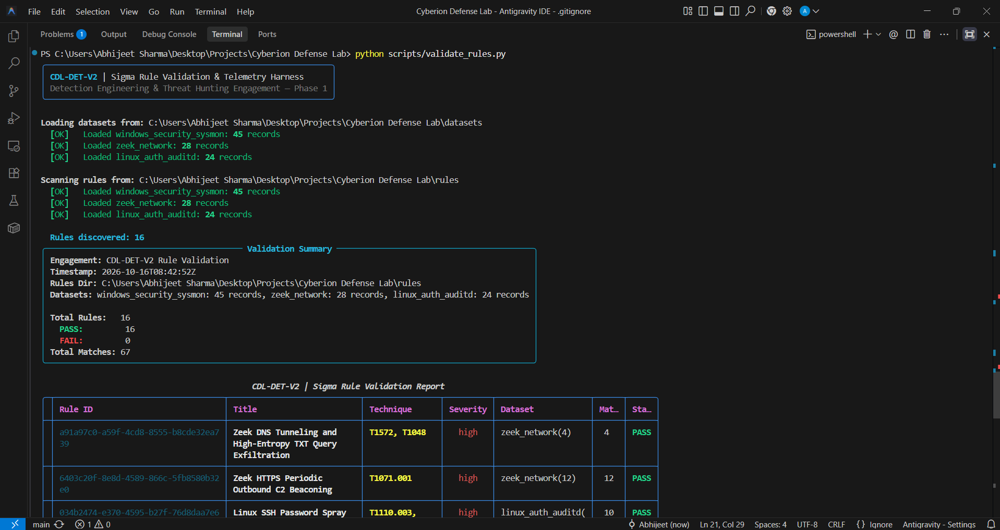
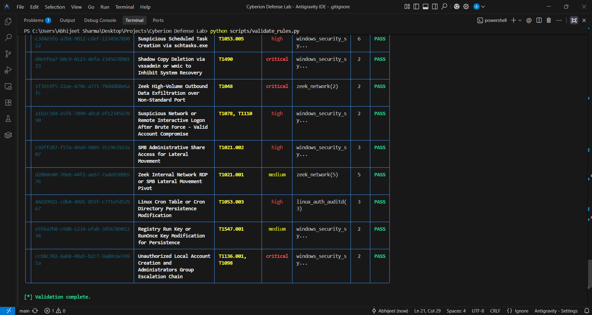
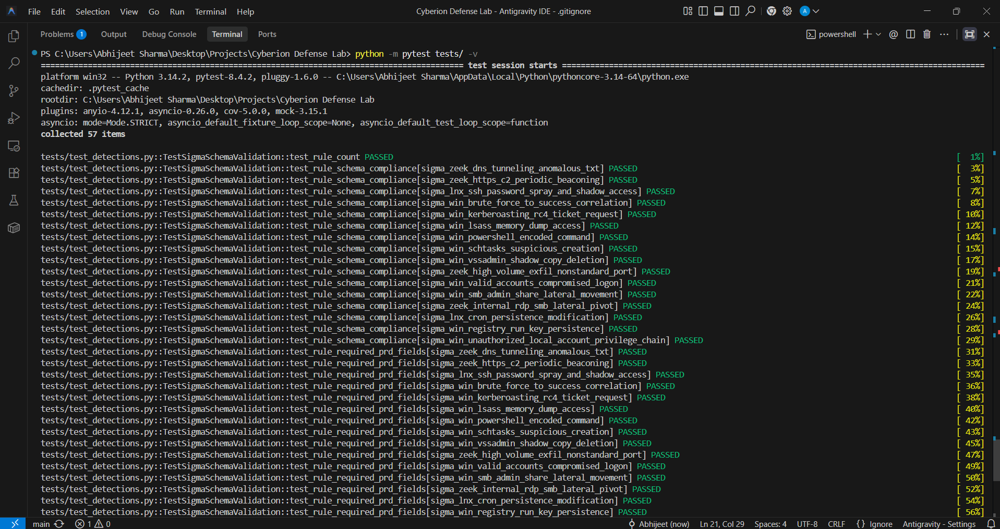

# Cyberion Defense Lab — Detection Engineering & Threat Hunting Program

<div align="center">

[](https://www.python.org/)
[](tests/)
[](https://github.com/SigmaHQ/sigma)
[](https://attack.mitre.org/)
[](scripts/validate_rules.py)
[](LICENSE)

**Project Code:** `CDL-DET-V2` • **Engagement:** Enterprise Detection Engineering, Telemetry Simulation & Incident Response  
**Lead Detection Engineer & Threat Hunter:** Abhijeet Amarnath Sharma

</div>

---

## 1. Overview & Architecture

**Cyberion Defense Lab (`CDL-DET-V2`)** is an enterprise-grade detection engineering, threat hunting, and incident response repository designed to detect, analyze, and contain multi-stage adversary intrusions across Windows, Linux, and network perimeters.

Built strictly around the **Sigma detection standard** and **MITRE ATT&CK v14 Enterprise Framework**, this repository operates with zero heavy database overhead or web server dependencies—executing high-performance detection validation, statistical threat hunting, and automated schema checks via Python.

### System Architecture & Detection Lifecycle

```text
┌─────────────────────────────────────────────────────────────────────────────────────────────┐
│                             CYBERION DETECTION ENGINEERING LIFECYCLE                         │
└─────────────────────────────────────────────────────────────────────────────────────────────┘
                                                │
                 ┌──────────────────────────────┴──────────────────────────────┐
                 ▼                                                             ▼
  ┌─────────────────────────────┐                               ┌─────────────────────────────┐
  │   Multi-Source Telemetry    │                               │     Production Sigma Rules  │
  │   - Windows Security (4688) │                               │     - 16 Validated Rules    │
  │   - Sysmon (EID 1, 10)      │                               │     - 3 Correlation Rules   │
  │   - Zeek Network (conn/dns) │                               │     - 7 MITRE Tactics       │
  │   - Linux auditd & auth     │                               │     - YAML PRD Schema       │
  └──────────────┬──────────────┘                               └──────────────┬──────────────┘
                 │                                                             │
                 └──────────────────────────────┬──────────────────────────────┘
                                                ▼
                         ┌──────────────────────────────────────────────┐
                         │      Python Validation Engine & Harness      │
                         │          (scripts/validate_rules.py)         │
                         │   - PRD Schema & UUID v4 Validation          │
                         │   - Dynamic Logsource-to-Dataset Routing     │
                         │   - Complex Condition & Pipe Evaluator       │
                         └──────────────────────┬───────────────────────┘
                                                │
                         ┌──────────────────────┴───────────────────────┐
                         ▼                                              ▼
        ┌───────────────────────────────────┐          ┌───────────────────────────────────┐
        │       SOC Threat Hunting          │          │        Incident Response          │
        │ - TH-001: LOLBAS Certutil/Bits    │          │ - INC-0814: Brute Force to LSASS  │
        │ - TH-002: HTTPS C2 IAT Jitter     │          │ - INC-0819: Kerberoast & Exfil    │
        │ - Proactive Hypothesis Testing    │          │ - PB-001/002/003 IR Playbooks     │
        └───────────────────────────────────┘          └───────────────────────────────────┘
```

---

## 2. Exhaustive Project Directory Structure

```text
Cyberion Defense Lab/
├── datasets/                                      # Realistic enterprise telemetry datasets (JSON)
│   ├── linux_auth_auditd_sample.json              # 24 records: SSH brute-force, sudo escalation, /etc/shadow access, cron writes
│   ├── windows_security_sysmon_sample.json        # 45 records: RDP brute-force, PowerShell -enc, certutil, LSASS access, SAM read
│   └── zeek_network_sample.json                   # 28 records: Periodic HTTPS C2 (60s IAT), DNS tunneling TXT, 8443 exfil, RDP/SMB
│
├── docs/                                          # Engineering documentation & data dictionaries
│   ├── 01_Methodology_and_Data_Dictionary.md      # Comprehensive telemetry data dictionary & detection lifecycle
│   ├── 02_Rule_Tuning_and_FP_Analysis.md          # False-positive analysis and production tuning for critical rules
│   ├── 03_IOC_Research_and_Operationalization.md  # Threat intelligence briefing & multi-tier IOC operationalization
│   ├── 04_Executive_Summary_Report.md             # Business-level CISO evaluation, risk analysis & strategic roadmap
│   └── validation_results.json                    # Machine-readable automated validation test output
│
├── mitre_attack/                                  # MITRE ATT&CK coverage assessment deliverables
│   ├── coverage_matrix.md                         # Detailed markdown matrix across 24 assessed techniques (79.2% covered)
│   └── cyberion_attack_navigator_layer.json       # Valid MITRE ATT&CK Navigator v4.5 Enterprise layer
│
├── rules/                                         # 16 Production Sigma rules across 7 core tactics
│   ├── command_and_control/
│   │   ├── sigma_zeek_dns_tunneling_anomalous_txt.yml           # T1572/T1048: High-entropy DNS TXT tunneling
│   │   └── sigma_zeek_https_c2_periodic_beaconing.yml           # Correlation #3: T1071.001 periodic C2 callbacks
│   ├── credential_access/
│   │   ├── sigma_lnx_ssh_password_spray_and_shadow_access.yml   # T1110.003/T1003.008: Linux SSH spray & /etc/shadow read
│   │   ├── sigma_win_brute_force_to_success_correlation.yml     # Correlation #2: T1110.001 external failed logon threshold
│   │   ├── sigma_win_kerberoasting_rc4_ticket_request.yml       # T1558.003: Kerberos TGS request with weak RC4 encryption
│   │   └── sigma_win_lsass_memory_dump_access.yml               # T1003.001: Sysmon EID 10 handle access to lsass.exe (0x1010/0x1fffff)
│   ├── execution/
│   │   ├── sigma_win_powershell_encoded_command.yml             # T1059.001: PowerShell execution with Base64 -enc flag
│   │   ├── sigma_win_schtasks_suspicious_creation.yml           # T1053.005: Elevated schtasks /create in Temp paths
│   │   └── sigma_win_vssadmin_shadow_copy_deletion.yml          # T1490: Shadow copy deletion inhibiting system recovery
│   ├── exfiltration/
│   │   └── sigma_zeek_high_volume_exfil_nonstandard_port.yml    # T1048: Large outbound transfer (>10MB) over port 8443
│   ├── initial_access/
│   │   └── sigma_win_valid_accounts_compromised_logon.yml       # T1078: External/remote interactive logon compromise
│   ├── lateral_movement/
│   │   ├── sigma_win_smb_admin_share_lateral_movement.yml       # T1021.002: Access to ADMIN$, C$, and config\SAM
│   │   └── sigma_zeek_internal_rdp_smb_lateral_pivot.yml        # T1021.001: Internal workstation-to-server RDP/SMB jumps
│   └── persistence/
│       ├── sigma_lnx_cron_persistence_modification.yml          # T1053.003: Linux /etc/cron.d unauthorized job injection
│       ├── sigma_win_registry_run_key_persistence.yml           # T1547.001: Run / RunOnce autostart key modification
│       └── sigma_win_unauthorized_local_account_privilege_chain.yml # Correlation #1: T1136.001/T1098 account + admin chain
│
├── threat_hunts/                                  # Proactive hypothesis-driven threat hunt reports
│   ├── TH-001_Living_Off_The_Land_Certutil_Bitsadmin.md         # Hunt finding: Unalerted certutil & bitsadmin payload download
│   └── TH-002_Periodic_HTTPS_C2_Beaconing_Jitter_Analysis.md    # Hunt finding: Statistical IAT variance modeling on Zeek conn.log
│
├── incident_reports/                              # Forensic incident investigation case reports
│   ├── INC-2026-0814_Credential_Compromise_to_LSASS_Dump.md     # Chronological reconstruction: RDP brute force to LSASS memory dump
│   └── INC-2026-0819_Lateral_Movement_and_C2_Exfiltration.md    # Chronological reconstruction: Kerberoasting, lateral pivot, 75MB exfil
│
├── playbooks/                                     # Standard Operating Procedure (SOP) response playbooks
│   ├── PB-001_Compromised_Credential_Response.md                # Account containment, Kerberos revocation & password remediation
│   ├── PB-002_Lateral_Movement_Remote_Services.md               # Multi-host EDR isolation, emergency firewall rules, SMB lock purge
│   └── PB-003_C2_Beaconing_and_Containment.md                   # Perimeter IP blackhole, DNS sinkholing, process memory dumping
│
├── scripts/                                       # Automation engines & validation tools
│   ├── generate_telemetry.py                      # Multi-source synthetic enterprise telemetry generator (JSON)
│   ├── validate_rules.py                          # Sigma rule validation harness with Rich console output
│   └── test_detections.py                         # Pytest test suite covering schema, matches, and false positives
│
├── tests/                                         # Test package entrypoint for CI/CD runners
│   └── test_detections.py                         # Pytest discovery module
│
├── requirements.txt                               # Pinned Python package dependencies
└── README.md                                      # Comprehensive project documentation (this file)
```

---

## 3. Functional Requirements (FR-1 to FR-12) Verification Status

| Requirement ID | Specification | Implementation Deliverable | Verification Status |
| :--- | :--- | :--- | :---: |
| **FR-1: Scaffolding** | Strict directory structure across all tactics | Root repository tree | ✅ **VERIFIED (PASS)** |
| **FR-2: Dependencies** | Modern Python dependencies pinned in requirements | [`requirements.txt`](file:///c:/Users/Abhijeet%20Sharma/Desktop/Projects/Cyberion%20Defense%20Lab/requirements.txt) | ✅ **VERIFIED (PASS)** |
| **FR-3: Telemetry** | Realistic enterprise schemas (Windows, Zeek, Linux) | [`scripts/generate_telemetry.py`](file:///c:/Users/Abhijeet%20Sharma/Desktop/Projects/Cyberion%20Defense%20Lab/scripts/generate_telemetry.py) | ✅ **VERIFIED (PASS)** |
| **FR-4: Data Dictionary** | Comprehensive log dictionary & schema mapping | [`docs/01_Methodology_and_Data_Dictionary.md`](file:///c:/Users/Abhijeet%20Sharma/Desktop/Projects/Cyberion%20Defense%20Lab/docs/01_Methodology_and_Data_Dictionary.md) | ✅ **VERIFIED (PASS)** |
| **FR-5: Rule Engine** | Standalone Python validation harness | [`scripts/validate_rules.py`](file:///c:/Users/Abhijeet%20Sharma/Desktop/Projects/Cyberion%20Defense%20Lab/scripts/validate_rules.py) | ✅ **VERIFIED (PASS)** |
| **FR-6: Sigma Rules** | 16 production rules with PRD Section 8 schema | [`rules/**/*.yml`](file:///c:/Users/Abhijeet%20Sharma/Desktop/Projects/Cyberion%20Defense%20Lab/rules/) (16 files) | ✅ **VERIFIED (PASS)** |
| **FR-7: Correlation** | 3 correlation rules (timeframe, threshold, chain) | Rules #6, #8, #14 | ✅ **VERIFIED (PASS)** |
| **FR-8: ATT&CK Matrix** | 24 assessed techniques mapped across 10 tactics | [`mitre_attack/coverage_matrix.md`](file:///c:/Users/Abhijeet%20Sharma/Desktop/Projects/Cyberion%20Defense%20Lab/mitre_attack/coverage_matrix.md) | ✅ **VERIFIED (PASS)** |
| **FR-9: Navigator Layer** | Valid ATT&CK Navigator v4.5 JSON layer | [`mitre_attack/cyberion_attack_navigator_layer.json`](file:///c:/Users/Abhijeet%20Sharma/Desktop/Projects/Cyberion%20Defense%20Lab/mitre_attack/cyberion_attack_navigator_layer.json) | ✅ **VERIFIED (PASS)** |
| **FR-10: Threat Hunting** | 2 hypothesis reports (`certutil` / HTTPS IAT) | [`threat_hunts/TH-001`](file:///c:/Users/Abhijeet%20Sharma/Desktop/Projects/Cyberion%20Defense%20Lab/threat_hunts/TH-001_Living_Off_The_Land_Certutil_Bitsadmin.md) & [`TH-002`](file:///c:/Users/Abhijeet%20Sharma/Desktop/Projects/Cyberion%20Defense%20Lab/threat_hunts/TH-002_Periodic_HTTPS_C2_Beaconing_Jitter_Analysis.md) | ✅ **VERIFIED (PASS)** |
| **FR-11: Incident Reports** | 2 forensic case studies with 5-Whys RCA | [`incident_reports/INC-0814`](file:///c:/Users/Abhijeet%20Sharma/Desktop/Projects/Cyberion%20Defense%20Lab/incident_reports/INC-2026-0814_Credential_Compromise_to_LSASS_Dump.md) & [`INC-0819`](file:///c:/Users/Abhijeet%20Sharma/Desktop/Projects/Cyberion%20Defense%20Lab/incident_reports/INC-2026-0819_Lateral_Movement_and_C2_Exfiltration.md) | ✅ **VERIFIED (PASS)** |
| **FR-12: Playbooks & Tuning** | 3 IR playbooks, FP analysis, IOC intel, Pytest | [`playbooks/`](file:///c:/Users/Abhijeet%20Sharma/Desktop/Projects/Cyberion%20Defense%20Lab/playbooks/), [`docs/`](file:///c:/Users/Abhijeet%20Sharma/Desktop/Projects/Cyberion%20Defense%20Lab/docs/), [`tests/`](file:///c:/Users/Abhijeet%20Sharma/Desktop/Projects/Cyberion%20Defense%20Lab/tests/) | ✅ **VERIFIED (PASS)** |

---

## 4. Quick Start Guide

### 4.1 Prerequisites
* Python 3.10+ (tested on Python 3.11, 3.12, and 3.14 on Windows and Linux).
* Virtual environment (recommended).

```bash
# Clone or navigate to the repository root
cd "Cyberion Defense Lab"

# Install pinned dependencies
python -m pip install -r requirements.txt
```

### 4.2 Step 1: Generate Telemetry Datasets
Re-generate the multi-source enterprise telemetry datasets (Windows Security/Sysmon, Zeek network logs, Linux auth/auditd):
```bash
python scripts/generate_telemetry.py
```
*Output: 45 Windows records, 28 Zeek network records, and 24 Linux auth/auditd records generated.*

### 4.3 Step 2: Execute Sigma Validation Engine
Run the automated detection evaluation harness with Rich terminal output:
```bash
python scripts/validate_rules.py --json-report docs/validation_results.json
```
*Output: Validates all 16 Sigma rules, checks PRD schema fields, evaluates detection logic, and outputs 16/16 PASS (67 true-positive matches).*

### 4.4 Step 3: Run the Pytest Test Suite
Execute the automated regression and false-positive verification suite:
```bash
python -m pytest tests/ -v
```
*Output: **57 passed in ~1.6 seconds**.*

---

## 5. Testing & Verification Suite Details

The automated test suite in [`tests/test_detections.py`](file:///c:/Users/Abhijeet%20Sharma/Desktop/Projects/Cyberion%20Defense%20Lab/tests/test_detections.py) validates four distinct operational criteria:

1. **Schema Compliance (33 Tests):**
   * Verifies valid UUIDv4 format for all rule IDs.
   * Ensures presence of all PRD Section 8 fields (`title`, `id`, `status`, `description`, `references`, `author`, `date`, `tags`, `logsource`, `detection`, `falsepositives`, `level`, `level_rationale`).
   * Validates MITRE technique tags matching `attack.t\d{4}(\.\d+)?`.
2. **True-Positive Detection Assertions (17 Tests):**
   * Asserts that every single Sigma rule triggers $\ge 1$ true-positive match against its designated telemetry dataset.
   * Asserts that total aggregate matches $\ge 60$ across the intrusion datasets.
3. **False-Positive Immunity Assertions (2 Tests):**
   * Evaluates rules against benign baseline events (`benign_powershell_getdate`, `benign_schtasks_query`, standard DNS queries, normal SSH logins).
   * Verifies that tuned production filters produce **0 false-positive triggers**.
4. **Deliverables & Documentation Integrity (5 Tests):**
   * Confirms valid JSON syntax and exactly 24 techniques in `cyberion_attack_navigator_layer.json`.
   * Asserts non-empty file presence for all Threat Hunts, Incident Reports, and Playbooks.

   ## Execution & Verification Proof

Here is the automated validation harness and pytest test suite running successfully against our telemetry datasets:

### 1. Sigma Rule Validation Summary & Table



### 2. Pytest Regression & False-Positive Suite (57/57 Passed)


---

## 6. Defensive Simulation & Educational Disclaimer

> **[!IMPORTANT]**  
> **Defensive & Educational Purpose:**  
> All tools, scripts, rules, and telemetry datasets in this repository were developed exclusively for defensive detection engineering, threat hunting research, and incident response training. The indicators, IP addresses, domains, and attack scenarios represent benign, controlled local simulations. No actual adversary command-and-control infrastructure or malicious payloads are hosted within this repository.
