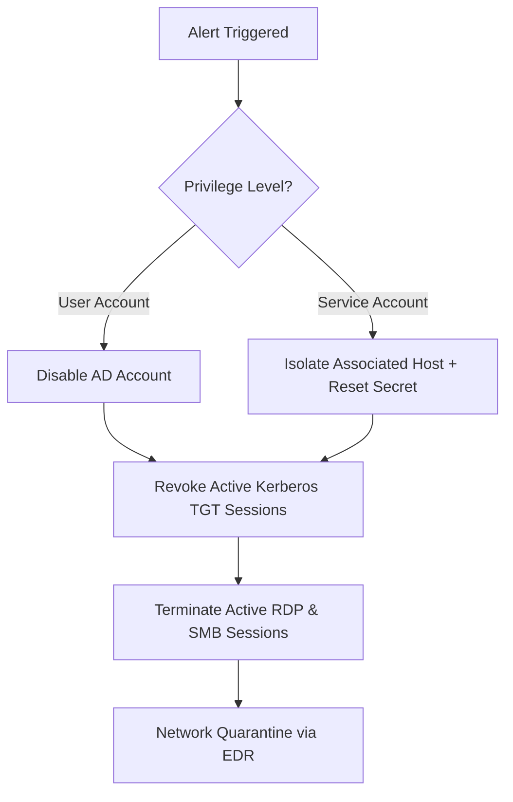

# Incident Response Playbook: PB-001

**Playbook Title:** Compromised User & Service Account Response Procedure  
**Project Code:** `PROJ-CYBE-260802` (internal baseline: `CDL-DET-V2`)  
**Playbook ID:** `PB-001`  
**Target Threat Category:** Credential Access (`TA0006`), Initial Access (`TA0001`), Persistence (`TA0003`)  
**Standard Compliance:** NIST SP 800-61 Rev. 2, CISA Incident Response Guidelines  
**Author:** Abhijeet Amarnath Sharma - Senior Detection Engineer & Incident Handler  
**Effective Date:** 2026-08-15  
**Version:** 2.0.0  
**Classification:** Internal Operational Procedure  

---

## 1. Overview & Trigger Conditions

This playbook establishes the standard operating procedure (SOP) for containing, investigating, and remediating compromised credentials across Active Directory domain accounts, local accounts, and service accounts.

### 1.1 Trigger Conditions
Initiate this playbook immediately upon encountering any of the following alerts:
* **Detection Trigger 1:** Sigma rule `sigma_win_valid_accounts_compromised_logon.yml` (`EventID: 4624` from external or untrusted source following authentication failures).
* **Detection Trigger 2:** Sigma rule `sigma_win_brute_force_to_success_correlation.yml` (Password spray exceeding threshold `>3` failed logons within 5 minutes followed by success).
* **Detection Trigger 3:** Sigma rule `sigma_win_kerberoasting_rc4_ticket_request.yml` (`EventID: 4769` requesting weak RC4 ticket `0x17` for sensitive SPN).
* **Detection Trigger 4:** Sigma rule `sigma_win_unauthorized_local_account_privilege_chain.yml` (Local user created via `4720` elevated to local Administrators via `4732`).
* **Detection Trigger 5:** Linux SSH password spray success in `sigma_lnx_ssh_password_spray_and_shadow_access.yml`.

---

## 2. Phase 1: Triage & Identification (< 15 Minutes)

### Step 1.1: Verify Alert Validity
1. Determine if the source IP is external, internal, or associated with authorized VPN/corporate egress:
   ```powershell
   # Check Active Directory lockout and bad password counter
   Get-ADUser -Identity "<CompromisedUser>" -Properties BadPwdCount, LastBadPasswordAttempt, LockedOut, LastLogonDate |
       Select-Object Name, BadPwdCount, LastBadPasswordAttempt, LockedOut, LastLogonDate
   ```
2. Inspect authentication telemetry for anomalous attributes:
   * **LogonType:** Type 3 (Network logon), Type 10 (Remote Interactive / RDP).
   * **SourceNetworkAddress:** Match against known threat intelligence indicators (e.g., `185.220.101.45`, `91.214.124.88`).
   * **WorkstationName:** Compare with known corporate asset naming conventions (`WS-FIN-*`, `WS-DEV-*`, `DC-PROD-*`).

### Step 1.2: Scope Account Privileges
* Check if the account belongs to privileged groups:
  ```powershell
  Get-ADPrincipalGroupMembership -Identity "<CompromisedUser>" | Select-Object Name
  ```
* If the account belongs to `Domain Admins`, `Enterprise Admins`, or has registered Service Principal Names (SPNs), immediately escalate incident severity to **CRITICAL (P1)**.

---

## 3. Phase 2: Immediate Containment (< 30 Minutes)



### Step 2.1: Account Disablement & Credential Revocation
1. **Disable the Compromised User Account:**
   ```powershell
   Disable-ADAccount -Identity "<CompromisedUser>"
   ```
2. **Terminate Active Kerberos Tickets:**
   Revoke existing Kerberos Ticket Granting Tickets (TGTs) to immediately invalidate cached tokens:
   ```powershell
   # Invalidate Kerberos tokens across domain controllers
   Revoke-ADUserTokens -Identity "<CompromisedUser>"
   ```
3. **Terminate Active Interactive & RDP Sessions on Affected Endpoints:**
   ```powershell
   # Query active sessions on host
   qwinsta /server:<Hostname>
   # Log off compromised session ID
   rwinsta <SessionID> /server:<Hostname>
   ```

### Step 2.2: Host-Level Isolation
If interactive logon or command execution occurred, issue an immediate network isolation command via EDR to prevent lateral pivoting:
```powershell
# EDR CLI or PowerShell Host Isolation
Invoke-EDRContainment -ComputerName "<TargetHost>" -Action Isolate
```

---

## 4. Phase 3: Forensic Artifact Collection & Evidence Preservation

Execute forensic triage commands to collect volatile evidence before system reboot:

### Step 3.1: Volatile Artifacts & Active Connections
```powershell
# Record active network sockets and listening ports
netstat -ano > C:\Cyberion_IR\netstat_dump.txt

# Capture running processes with parent PID mapping
wmic process get Caption, ProcessId, ParentProcessId, CommandLine /format:csv > C:\Cyberion_IR\process_tree.csv

# Export Security and Sysmon logs covering the intrusion window
wevtutil epl Security C:\Cyberion_IR\Security_Incident.evtx /q:"*[System[TimeCreated[timediff(@SystemTime) <= 86400000]]]"
wevtutil epl Microsoft-Windows-Sysmon/Operational C:\Cyberion_IR\Sysmon_Incident.evtx /q:"*[System[TimeCreated[timediff(@SystemTime) <= 86400000]]]"
```

### Step 3.2: Persistence & Local Backdoor Inspection
```powershell
# Inspect local Administrators group members
Get-LocalGroupMember -Group "Administrators" | Select-Object Name, PrincipalSource, SID

# Inspect registry Run keys for autostart payloads
Get-ItemProperty "HKLM:\SOFTWARE\Microsoft\Windows\CurrentVersion\Run"
Get-ItemProperty "HKCU:\SOFTWARE\Microsoft\Windows\CurrentVersion\Run"

# List scheduled tasks created within the last 24 hours
Get-ScheduledTask | Get-ScheduledTaskInfo | Where-Object { $_.LastTaskResult -ne 0 -or $_.LastRunTime -gt (Get-Date).AddDays(-1) }
```

---

## 5. Phase 4: Eradication & Remediation

1. **Password Reset with High Complexity:**
   * Generate a random 32-character passphrase.
   * Enable "User must change password at next logon".
   * For Service Accounts with SPNs (`svc_mssql`, `svc_backup`), enforce AES-256 encryption (`msDS-SupportedEncryptionTypes = 24`) to eliminate RC4 Kerberoasting vulnerabilities.
2. **Remove Rogue Accounts & Backdoors:**
   * Delete unauthorized local accounts created during the attack:
     ```powershell
     Remove-LocalUser -Name "support_adm"
     ```
   * Remove malicious scheduled tasks and registry keys:
     ```powershell
     Unregister-ScheduledTask -TaskName "WindowsUpdate" -Confirm:$false
     Remove-ItemProperty -Path "HKLM:\SOFTWARE\Microsoft\Windows\CurrentVersion\Run" -Name "WindowsSvcHost"
     ```
3. **Double `krbtgt` Password Reset (If Domain Compromise Occurred):**
   * If Kerberos ticket dumping or domain admin compromise was observed, execute the Microsoft `New-KrbtgtKeys.ps1` script twice, spaced 24 hours apart, to invalidate all Golden/Silver ticket forgeries.

---

## 6. Phase 5: Stakeholder Communication & Reporting

| Stakeholder | Timing | Delivery Channel | Required Details |
| :--- | :--- | :--- | :--- |
| **SOC Manager / CISO** | T + 30m | Encrypted Signal / Out-of-band Email | High-level summary, affected user/host, initial containment status |
| **Identity / Active Directory Team** | T + 45m | Jira IR Ticket | List of accounts disabled, SPN configurations requiring AES migration |
| **Affected User Manager** | T + 2h | Corporate Email / Phone | Notification of account compromise and temporary work arrangements |
| **Legal & Privacy Counsel** | T + 4h | Secure Conference | Briefing on data exposure (if PII/financial data was accessible to account) |

---

## 7. Metrics & Verification Checklist

- [ ] All compromised user and service accounts disabled or passwords reset.
- [ ] Active Kerberos sessions revoked.
- [ ] Rogue local accounts deleted.
- [ ] Persistence scheduled tasks and registry keys deleted.
- [ ] Post-incident validation query executed in SIEM with **zero** subsequent authentication events from offending IPs.
- [ ] Case documentation updated in ticketing system and linked to `INC-2026-0814`.
