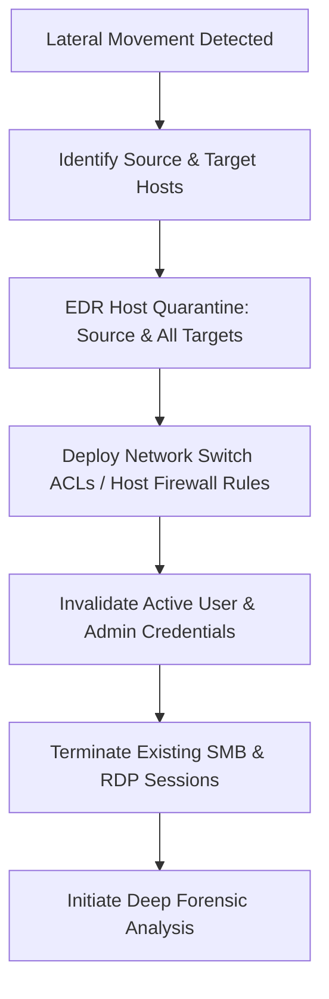

# Incident Response Playbook: PB-002

**Playbook Title:** Lateral Movement & Remote Services Containment Playbook  
**Project Code:** `PROJ-CYBE-260802` (internal baseline: `CDL-DET-V2`)  
**Playbook ID:** `PB-002`  
**Target Threat Category:** Lateral Movement (`TA0008`), Remote Services (`T1021`)  
**Standard Compliance:** NIST SP 800-61 Rev. 2, MITRE D3FEND Framework  
**Author:** Abhijeet Amarnath Sharma - Senior Detection Engineer & Incident Handler  
**Effective Date:** 2026-08-15  
**Version:** 2.0.0  
**Classification:** Internal Operational Procedure  

---

## 1. Overview & Trigger Conditions

This playbook outlines procedures for detecting, containing, and eradicating internal lateral movement traversing enterprise networks via Remote Desktop Protocol (RDP), Server Message Block (SMB), Windows Remote Management (WinRM), and Administrative File Shares (`ADMIN$`, `C$`, `IPC$`).

### 1.1 Trigger Conditions
Initiate this playbook immediately upon receiving alerts from:
* **Detection Trigger 1:** Sigma rule `sigma_win_smb_admin_share_lateral_movement.yml` (`EventID: 5140` / `5145` accessing `ADMIN$`, `C$`, or `config\SAM` from a non-DC host).
* **Detection Trigger 2:** Sigma rule `sigma_zeek_internal_rdp_smb_lateral_pivot.yml` (Anomalous internal cross-subnet RDP [3389] or SMB [445] traffic captured in Zeek `conn.log`).
* **Detection Trigger 3:** EDR behavioral alert for remote service installation (`EventID: 7045` / `PsExec` / `WMI` remote invocation).

---

## 2. Phase 1: Triage & Blast Radius Mapping (< 20 Minutes)

### Step 1.1: Identify the Pivot Origin and Target Hosts
Execute targeted SIEM queries to establish the movement graph:

```sql
-- Identify all destination hosts contacted by suspect pivot host
SELECT 
    id_orig_h AS Source_IP, 
    id_resp_h AS Destination_IP, 
    id_resp_p AS Port, 
    service AS Protocol, 
    COUNT(*) AS Session_Count, 
    SUM(orig_bytes) AS Total_Bytes_Sent
FROM zeek_network
WHERE id_orig_h IN ('10.20.1.15', '<Suspect_Source_IP>')
  AND id_resp_p IN (445, 3389, 5985, 5986, 135)
GROUP BY id_orig_h, id_resp_h, id_resp_p, service
ORDER BY Total_Bytes_Sent DESC;
```

### Step 1.2: Check Share Access Events
Correlate Windows Event Log 5140 and 5145 records to verify if sensitive hives were staged:
```sql
SELECT 
    TimeCreated, Computer, SubjectUserName, IpAddress, ShareName, RelativeTargetName
FROM windows_security_sysmon
WHERE EventID IN (5140, 5145)
  AND (
      ShareName LIKE '%ADMIN$%' 
      OR ShareName LIKE '%C$%' 
      OR RelativeTargetName LIKE '%SAM%' 
      OR RelativeTargetName LIKE '%SYSTEM%'
  )
ORDER BY TimeCreated ASC;
```

---

## 3. Phase 2: Immediate Containment (< 30 Minutes)



### Step 2.1: Multi-Host EDR Network Isolation
Immediately isolate both the **originating weaponized host** and **all secondary targeted systems**:
```powershell
# Isolate source pivot host
Invoke-EDRContainment -ComputerName "WS-FIN-04.cyberion.local" -Action Isolate

# Isolate secondary target hosts
Invoke-EDRContainment -ComputerName "WS-DEV-02.cyberion.local" -Action Isolate
```
*Note: Do NOT isolate Primary Domain Controllers (`DC-PROD-01`) without CISO approval; instead, apply strict host firewall rules on the DC.*

### Step 2.2: Enforce Host Firewall Emergency Rules
Deploy immediate Group Policy or local PowerShell firewall rules blocking inbound SMB and RDP from the affected subnet:
```powershell
# Block inbound SMB (445) from workstation subnets onto DC
New-NetFirewallRule -DisplayName "EMERGENCY - Block Inbound SMB from Workstations" `
    -Direction Inbound -LocalPort 445 -Protocol TCP -Action Block `
    -RemoteAddress 10.20.1.0/24 -Profile Any

# Block inbound RDP (3389) across all servers
New-NetFirewallRule -DisplayName "EMERGENCY - Block Inbound RDP" `
    -Direction Inbound -LocalPort 3389 -Protocol TCP -Action Block `
    -RemoteAddress 10.20.1.0/24 -Profile Any
```

### Step 2.3: Close Active Network File Shares & Sessions
```powershell
# Enumerate and forcibly disconnect open SMB sessions on file servers / DCs
Get-SmbSession | Where-Object { $_.ClientComputerAddress -like "10.20.1.*" } | Close-SmbSession -Force

# Terminate open files accessed over administrative shares
Get-SmbOpenFile | Where-Object { $_.Path -like "*SAM*" -or $_.Path -like "*SYSTEM*" } | Close-SmbOpenFile -Force
```

---

## 4. Phase 3: Forensic Artifact Collection

### Step 4.1: Remote Execution & Lateral Artifacts
Inspect evidence of remote service installation and command staging on target systems:
```powershell
# 1. Check for Service Creation Events (EventID 7045 / 4697)
Get-WinEvent -FilterHashtable @{LogName='System'; Id=7045} | Select-Object TimeCreated, Message | Format-List

# 2. Check for RDP Bitmap Cache and Session History
reg query "HKCU\Software\Microsoft\Terminal Server Client\Default" /s

# 3. Check for Staged Files in Temp and Admin Share Roots
Get-ChildItem -Path "C:\Windows\Temp\", "C:\Users\Public\" -Recurse -File | 
    Select-Object FullName, Length, CreationTime, LastWriteTime | Sort-Object LastWriteTime -Descending
```

---

## 5. Phase 4: Eradication & Remediation

1. **Purge Compromised Administrative Credentials:**
   * Rotate all domain accounts, service accounts, and local admin passwords utilized during the lateral jump window.
   * If local SAM databases were accessed (`RelativeTargetName: Windows\System32\config\SAM`), immediately reset all local administrator passwords across every enterprise workstation via Microsoft LAPS.
2. **Remove Remotely Installed Services & Scheduled Tasks:**
   * Remove any unauthorized services registered via `sc.exe`, `psexec`, or WMI.
   * Verify integrity of `C:\Windows\System32\` and verify digital signatures of all recently written binaries.
3. **Audit Active Directory Group Memberships:**
   * Ensure no accounts were added to `Domain Admins`, `Enterprise Admins`, or `Account Operators`.

---

## 6. Phase 5: Architectural Hardening & Prevention

1. **Deploy Workstation-to-Workstation Isolation:**
   * Implement Windows Defender Firewall rules blocking TCP ports 135, 139, 445, 3389, and 5985 between user endpoints. User workstations must never establish peer-to-peer administrative sessions.
2. **Enforce SMB Signing & Encryption:**
   * Enable mandatory SMB signing and SMB encryption on all file servers and domain controllers (`Set-SmbServerConfiguration -RequireSecuritySignature $true`).
3. **Privileged Access Workstations (PAWs):**
   * Require all administrative access to servers and domain controllers to originate exclusively from dedicated, hardened PAWs traversing a dedicated Management VLAN with jump host jump-boxes.

---

## 7. Metrics & Verification Checklist

- [ ] All origin and secondary pivot hosts contained and network-quarantined.
- [ ] Emergency firewall drop rules active for cross-subnet SMB/RDP.
- [ ] All open SMB sessions and file locks terminated.
- [ ] Local and domain administrator passwords rotated across the blast radius.
- [ ] Zero active lateral movement connections observed in Zeek `conn.log` over 6 hours of monitoring.
- [ ] Post-incident review documented and linked to incident record `INC-2026-0819`.
