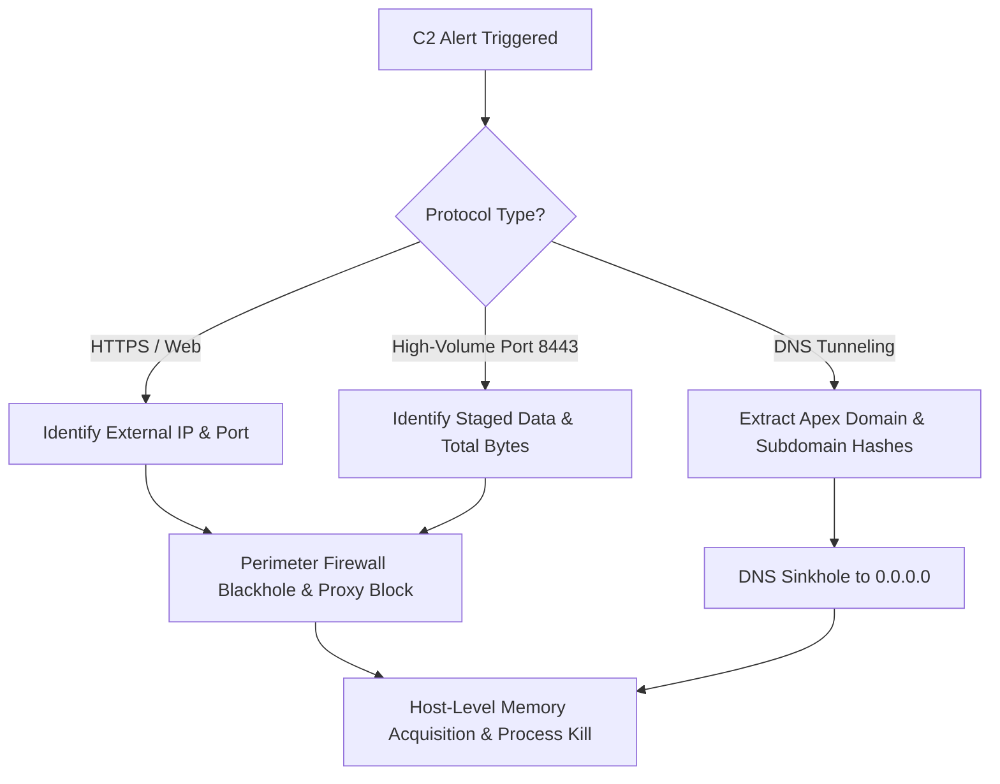

# Incident Response Playbook: PB-003

**Playbook Title:** Command & Control (C2) Beaconing & Egress Containment Playbook  
**Project Code:** `CDL-DET-V2`  
**Playbook ID:** `PB-003`  
**Target Threat Category:** Command and Control (`TA0011`), Exfiltration (`TA0010`)  
**Standard Compliance:** NIST SP 800-61 Rev. 2, SANS Incident Handler's Handbook  
**Author:** Abhijeet Amarnath Sharma - Senior Detection Engineer & Incident Handler  
**Effective Date:** 2026-08-15  
**Version:** 2.0.0  
**Classification:** Internal Operational Procedure  

---

## 1. Overview & Trigger Conditions

This playbook outlines procedures for rapidly severing adversary command-and-control (C2) callback loops, containing covert DNS tunneling channels, and terminating high-volume outbound data exfiltration streams traversing perimeter boundaries.

### 1.1 Trigger Conditions
Initiate this playbook immediately upon receiving alerts from:
* **Detection Trigger 1:** Sigma rule `sigma_zeek_https_c2_periodic_beaconing.yml` (Periodic outbound HTTPS callbacks exceeding `>5` connections in 10m to external C2 IPs).
* **Detection Trigger 2:** Sigma rule `sigma_zeek_dns_tunneling_anomalous_txt.yml` (Anomalous high-entropy TXT record DNS tunneling queries directed to suspicious subdomains).
* **Detection Trigger 3:** Sigma rule `sigma_zeek_high_volume_exfil_nonstandard_port.yml` (Outbound data transfer exceeding 10 MB over non-standard port 8443).
* **Detection Trigger 4:** Threat Hunt finding from `TH-002` (Statistical IAT clustering with Coefficient of Variation $\text{CV} < 0.25$).

---

## 2. Phase 1: Triage & C2 Protocol Identification (< 15 Minutes)



### Step 1.1: Extract C2 Network Attributes
Review Zeek connection and DNS telemetry to isolate the communication channel:
```sql
-- Query active outbound C2 traffic in Zeek conn.log
SELECT 
    ts, id_orig_h, id_resp_h, id_resp_p, proto, service, orig_bytes, resp_bytes, duration
FROM zeek_network
WHERE id_resp_h IN ('185.220.101.45', '45.133.1.92')
   OR id_resp_p IN (8443, 443, 53)
ORDER BY ts ASC;
```

### Step 1.2: Check DNS Queries for Tunneling Patterns
```sql
-- Check DNS TXT queries for Base64 exfiltration or tunnel indicators
SELECT 
    ts, id_orig_h, id_resp_h, qtype_name, query
FROM zeek_network
WHERE qtype_name = 'TXT'
  AND (query LIKE '%tunnel%' OR query LIKE '%exfil%' OR LENGTH(query) > 50)
ORDER BY ts ASC;
```

---

## 3. Phase 2: Immediate Perimeter & Host Containment (< 20 Minutes)

### Step 2.1: Perimeter Firewall Blackhole (Immediate Egress Severance)
Block adversary IP addresses bidirectionally at edge perimeter firewalls and BGP routing tables:
```bash
# Edge Firewall CLI (Palo Alto / Fortinet / iptables equivalent)
# Null-route external C2 infrastructure
iptables -I FORWARD -d 185.220.101.45/32 -j DROP
iptables -I FORWARD -d 45.133.1.92/32 -j DROP
iptables -I FORWARD -p tcp --dport 8443 -j DROP
```

### Step 2.2: Internal DNS Sinkhole Injection
Configure enterprise DNS servers (`10.20.0.2`) to blackhole malicious domains to prevent further tunnel resolution:
```powershell
# Windows Server DNS Sinkhole Record Injection
Add-DnsServerResourceRecordA -ZoneName "cyberion.local" -Name "tunnel.cyberion-exfil.com" `
    -IPv4Address "0.0.0.0" -TimeToLive 00:01:00

# Flush local DNS resolver cache across internal clients
Clear-DnsClientCache
```

### Step 2.3: Host Network Isolation & Memory Triage
1. Issue EDR quarantine on originating internal hosts (`WS-FIN-04` at `10.20.1.15`, `WS-DEV-02` at `10.20.1.22`).
2. Identify the specific process binding the outbound network socket before killing it:
   ```powershell
   # Map foreign IP to active process ID
   Get-NetTCPConnection -RemoteAddress "185.220.101.45" | Select-Object LocalAddress, LocalPort, RemoteAddress, RemotePort, State, OwningProcess
   
   # Retrieve process details
   Get-Process -Id <OwningProcessID> | Select-Object Id, ProcessName, Path, CommandLine
   ```
3. Capture a memory dump of the offending process for reverse engineering:
   ```powershell
   # Create mini-dump for reverse engineering
   rundll32.exe C:\Windows\System32\comsvcs.dll, MiniDump <OwningProcessID> C:\Cyberion_IR\c2_implant.dmp full
   ```
4. Forcibly terminate the implant process:
   ```powershell
   Stop-Process -Id <OwningProcessID> -Force
   ```

---

## 4. Phase 3: Exfiltration Assessment & Data Impact Analysis

### Step 4.1: Compute Exact Data Loss Volume
Review cumulative Zeek `orig_bytes` transmitted during the incident window:
* Session 1 (`WS-FIN-04` -> `45.133.1.92:8443`): **54,321,890 bytes (~54.3 MB)**
* Session 2 (`WS-DEV-02` -> `45.133.1.92:8443`): **21,456,000 bytes (~21.5 MB)**
* Total Confirmed Data Loss: **75,777,890 bytes (~75.8 MB)**

### Step 4.2: Identify Staged File Artifacts
Inspect local drives for compressed zip/tar/7z archives or staging directories created immediately prior to exfiltration:
```powershell
# Search for recently created archives or temporary files (>10MB)
Get-ChildItem -Path "C:\" -Include *.zip, *.rar, *.7z, *.tar, *.gz, *.cab, *.bak -Recurse -ErrorAction SilentlyContinue |
    Where-Object { $_.LastWriteTime -gt (Get-Date).AddDays(-2) -and $_.Length -gt 10MB } |
    Select-Object FullName, Length, LastWriteTime
```

---

## 5. Phase 4: Eradication & Long-Term Root Cause Resolution

1. **Eradicate Host Persistence Implants:**
   * Remove scheduled tasks and registry keys that spawn the C2 implant process upon reboot.
   * Delete staged malware binaries:
     * `C:\Users\j.doe\AppData\Local\Temp\svchost32.exe`
     * `C:\Windows\Temp\update.dll`
     * `C:\Windows\Temp\procdump64.exe`
2. **Re-image Compromised Systems:**
   * Re-image `WS-FIN-04` and `WS-DEV-02` from known-good baseline golden images. Host recovery without a complete wipe is prohibited for systems that established interactive C2 sessions.
3. **Submit Hashes to Threat Intelligence Platforms:**
   * Submit extracted MD5/SHA256 hashes of `svchost32.exe` and `update.dll` to VirusTotal, AlienVault OTX, and internal MISP instances to enrich detection catalogs.

---

## 6. Phase 5: Preventative Architectural Safeguards

1. **Mandatory Explicit Proxy Routing:**
   * Prohibit direct egress routing from user VLANs to the internet on all TCP/UDP ports. All outbound web requests must be handled via explicit proxy with SSL inspection.
2. **DNS Egress Lockdown:**
   * Block all outbound UDP/TCP port 53 traffic at the perimeter firewall except from designated enterprise DNS forwarders (`10.20.0.2`). This completely neutralizes direct client-to-internet DNS tunneling.
3. **JA3 / JA4 Fingerprint Enforcing:**
   * Enforce perimeter blocking on unrecognized TLS client fingerprints that do not match enterprise-approved operating systems and browser builds.

---

## 7. Metrics & Verification Checklist

- [ ] All C2 destination IPs and domains blocked at firewall, proxy, and DNS layers.
- [ ] Active implant processes identified, dumped to disk, and terminated.
- [ ] Compromised hosts quarantined and scheduled for clean re-imaging.
- [ ] Cumulative exfiltration volume measured and briefed to Legal / Privacy teams.
- [ ] Zero outbound connection attempts to C2 indicators over 24 hours of monitoring.
- [ ] Playbook execution metrics and timeline archived in incident file `INC-2026-0819`.
